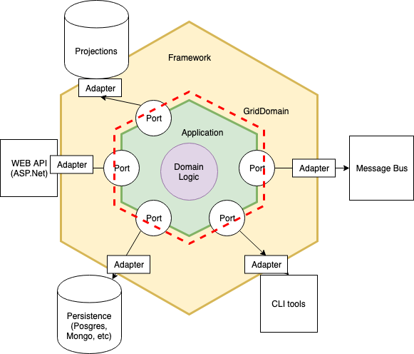
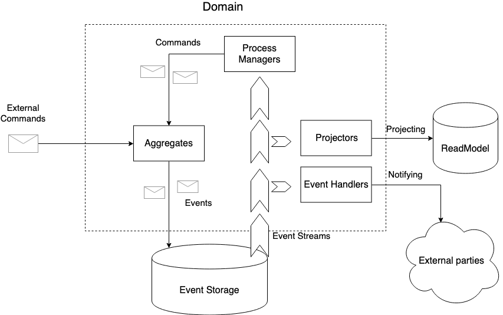
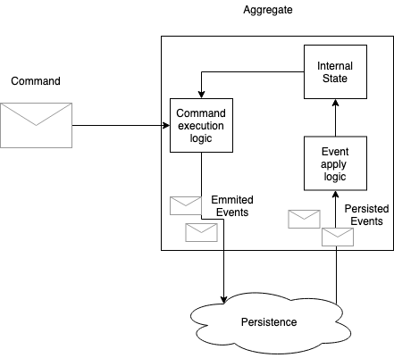

# GridDomain

**Distributed .NET Framework for Domain-Driven Design (DDD), CQRS, and Event Sourcing powered by the Akka.NET Actor Model.**

---

## Overview

**GridDomain** is an architectural framework designed for building domain-centric, scalable, and fault-tolerant distributed applications in C# / .NET without sacrificing domain model purity.

It abstracts infrastructure complexity—message routing, actor supervision, event persistence, distributed clustering, snapshots, and read-model projections—allowing engineering teams to focus directly on high-value business logic and tactical **Domain-Driven Design (DDD)**.

---

## Core Architectural Pillars

- **Tactical Domain-Driven Design (DDD):** Rich, persistence-ignorant `Aggregate` roots and domain entities (`GridDomain.Aggregates`, `GridDomain.Domains`) free of infrastructure boilerplate.
- **Command Query Responsibility Segregation (CQRS):** Explicit command execution pipelines with asynchronous or wait-for-confirmation execution semantics (`GridDomain.CQRS`, `GridDomain.Node`).
- **Event Sourcing (ES):** Immutable domain event streams with automated state hydration, snapshotting policies, and versioned event adapters (`GridDomain.EventSourcing`).
- **Stateful Actor Execution (Akka.NET):** Aggregates and projections execute inside supervised actor hierarchies (`GridDomain.Node.Akka`, `GridDomain.Common.Akka`) with first-class Akka.Cluster support.
- **Process Managers & Sagas:** Long-running distributed business workflows coordinated via domain events and compensating commands (`docs/articles/concepts/process_managers.md`).
- **Read-Model Projections:** Pluggable SQL and Entity Framework Core projection builders (`GridDomain.Projections.Akka.Sql`, `GridDomain.Projections.EntityFrameworkCore`).
- **Scenario-Based BDD Testing:** Fluent scenario testing DSL (`GridDomain.Scenarios`) for deterministic verification of aggregates, sagas, and event handlers in memory or against SQL journals.

---

## Repository Structure

| Module | Responsibility |
| :--- | :--- |
| `src/GridDomain.Abstractions` | Core contracts for commands, domain events, aggregates, and message routing |
| `src/GridDomain.Aggregates` | Base aggregate root abstractions and command/event convention routing |
| `src/GridDomain.Domains` | Domain configuration, bounded context registration, and dependency wiring |
| `src/GridDomain.EventHandlers` | Asynchronous event handler pipelines and Akka actor subscribers |
| `src/GridDomain.Projections` | Read-model projection builders for Akka SQL & Entity Framework Core |
| `src/GridDomain.Node` | Execution node host, command bus orchestration, and Akka.NET actor system lifecycle |
| `src/GridDomain.Scenarios` | Declarative Given/When/Then scenario runner for unit and integration testing |
| `docs/` | DocFX architectural documentation, concept guides, and diagrams |

---

## Aggregate Execution Flow

1. **Command Dispatch:** A typed `ICommand` is dispatched to the `GridDomain.Node` gateway.
2. **Actor Activation:** The target Aggregate Actor hydrates its state from the Event Store (or latest snapshot).
3. **Domain Execution:** The Aggregate validates invariants and emits uncommitted `DomainEvent` instances.
4. **Atomic Persistence:** Events are persisted via `Akka.Persistence` journals (`SqlServer` / in-memory).
5. **Projection & Saga Fan-Out:** Downstream projections and Process Managers react asynchronously to emitted events.

---

## Companion Repositories

- [**ContextCore/GridDomain.Examples**](https://github.com/ContextCore/GridDomain.Examples) — Reference patterns and sample implementations.
- [**ContextCore/GridDomain.Shop**](https://github.com/ContextCore/GridDomain.Shop) — E-commerce microservice reference application built on GridDomain.
- [**ContextCore/MightyCalc**](https://github.com/ContextCore/MightyCalc) — Distributed calculation cluster built with GridDomain and Akka.Cluster.

---

## Author & Maintainer

Architected and maintained by **[Andrey Leskov](https://github.com/andreyleskov)** — CTO, Founder & Principal Systems Architect ([illumi.one](https://illumi.one) · [LinkedIn](https://linkedin.com/in/andrey-leskov)).
